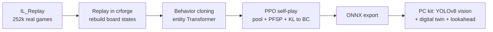

# Clash Royale Reinforcement Learning Agent

A deep reinforcement learning agent for Clash Royale. It learns the 2.6 Hog Cycle deck from about
260,000 real games (behavior cloning), improves through **PPO self-play** in the open-source
[crforge](https://github.com/voonhous/crforge) simulator, and plays the real game through a
computer-vision bridge (YOLOv8 detection, tracking and a simulated "digital twin" of the match).

The policy is a **Transformer over game entities** (troops, buildings, towers, spells) with masked,
autoregressive card and tile heads, written in PyTorch and exported to ONNX. Training ran on a Slurm
GPU cluster.

 
 

## Highlights

- **Imitation learning at scale**: real IL_Replay games replayed tick by tick in the simulator to
  rebuild the full board state behind every human move (1.7 M training rows for the 2.6 deck alone,
  about 260,000 games for the all-deck pre-training).
- **Entity Transformer policy** (1.2 M, then 4.6 M parameters): multi-head self-attention over up to
  200 entities, a 7-way first action (wait, 4 card slots, 2 abilities), then a tile over a 18 x 32 grid
  conditioned on the card, illegal-move masking and a value head.
- **PPO self-play** with GAE, KL regularization towards the imitation policy, an opponent pool with
  **PFSP** sampling (as in AlphaStar), a **privileged critic** (asymmetric actor-critic) and reward
  shaping. 512 games in parallel, about 41 M decisions per hour on one node.
- **Domain randomization for sim-to-real**: random card and tower levels, random evolution/hero
  forms, corrupted observations (missed units, position noise, missed enemy plays) and action delay.
- **Evaluation**: head-to-head matches under real-game noise, Elo league over checkpoints, worst score
  against older versions, cards played per minute.
- **Real-game bridge**: screen capture, two YOLOv8 detectors, alpha-beta tracking, elixir/hand/timer
  reading, the exact simulator observation rebuilt field by field, a crforge digital twin running in
  parallel, and a tile lookahead search in the twin before each play.

## Results

All matches are 400 games under real-game conditions (noisy input and 0.25 s delay on both sides),
temperature 0.5, margin about ±5 points. Full log: [docs/experiments.md](docs/experiments.md).

| Model | Parameters | How it was trained | Result |
|---|---|---|---|
| BC v1 | 1.19 M | imitation on 13,218 games of 2.6 players | beats crforge's scripted bot 75 % of the time |
| PPO v1 (it1450) | 1.19 M | PPO self-play from BC v1 | 81.5 % vs BC v1 (800 games) |
| PPO real-game (reel_it0400) | 1.19 M | PPO with domain randomization | 61 % vs PPO v1 |
| BC v2 (bc_tout_26) | 4.56 M | imitation on all decks, then fine-tuned on 2.6 | **82.8 % vs BC v1**, 54.5 % vs reel_it0400 |
| PPO v2 (released) | 4.56 M | PPO from BC v2 (gamma 0.999, permanent tower bonus, PFSP, privileged critic, domain randomization), weights averaged over 15 checkpoints | model used by the PC kit |

What the experiments taught:
- A bigger network trained on more data did more than every PPO run: BC v2 matches the best PPO
  model without any RL.
- PPO regressed in three runs out of three when the tower-damage bonus decayed to 0. With gamma 0.995
  and 4 decisions per second, the final reward only weighs half 35 s before the end of a 3-minute
  game. The next runs keep a permanent bonus and use gamma 0.999.
- Noisy vision costs the bot about 13 points in simulation, and the tile lookahead in the twin wins
  71 % against the same bot without it (80 games). See [bridge/README.md](bridge/README.md).

## How it works



**1. Data.** [IL_Replay](https://huggingface.co/datasets/VanguardX101/IL_Replay) only stores the moves
(card, tile, tick), not the board. `sim/il_to_crforge.py` infers each player's starting hand and
cycle from the order of the cards played, orders the deck so that crforge deals that exact hand, and
replays both players' moves. Every decision of the converted game gets the simulator's observation,
in the same format as during RL.

**2. Policy network** (`models/policy.py`). The observation is 224 header integers (elixir, hand,
cycle, timers, towers, last enemy plays) and up to 200 entity rows of 34 integers. Each entity becomes
a token from learned embeddings (card, kind, side, state, buffs) and scaled numeric features; the
header becomes one more token. A pre-norm Transformer encoder mixes them. A trunk then gives the
logits of the first choice (wait, play slot 0 to 3, ability 0 or 1) and, for each slot, a log-softmax
over the 576 tiles. Illegal choices are masked using the simulator's 2,307-action mask. During
training only, the critic can also see the opponent's header (hand, elixir, cycle).

**3. Behavior cloning** (`train/bc.py`). Cross-entropy on the human move with a value loss on the
game result. Only about 4 % of the decision steps contain a play, so most "wait" steps are dropped
and a log prior is added back to the wait logit. Pre-training on all decks and both players, then
fine-tuning on the 2.6.

**4. PPO self-play** (`train/ppo.py`). Half of the games are pure self-play, half are against a pool
of past versions sampled with PFSP. Reward: +1/-1 at the end plus a tower-damage bonus. KL penalty
towards the BC policy, critic warm-up, checkpoints and clean stops for 8-hour Slurm jobs
(`--max-hours`, `--resume`). Regular checks against the starting model and the scripted bot keep the
best checkpoint.

**5. Evaluation** (`eval/`). `play.py` plays a checkpoint against another one, the scripted bot or a
random bot. `head_to_head.py` adds the noise and the delay of the PC kit and counts cards per minute
(a high score against a passive opponent means nothing). `league.py` builds an Elo ranking of all
checkpoints and shows each one's worst score against older versions, to catch forgetting.

**6. Real game** (`bridge/`). A Windows kit for Google Play Games for PC: it reads the screen, rebuilds
the observation the bot was trained on, keeps a crforge twin of the match in sync with what it sees,
and clicks. It only plays friendly matches.

## Repository layout

| Folder | Content |
|---|---|
| `sim/` | crforge integration, deck definition, IL_Replay to crforge converter |
| `models/` | entity Transformer policy, ONNX export |
| `train/` | behavior cloning and PPO self-play |
| `eval/` | matches, head-to-head under real-game noise, Elo league |
| `rg/` | second pipeline on the RoyaleGym simulator (BC, PPO, evaluation) |
| `bridge/` | sim-to-real: Windows kit (vision, state, digital twin) and a bench that measures its cost |
| `scripts/` | dataset download and filtering, setup check, cluster packaging, Slurm pipeline |
| `docs/` | experiment log, roadmap, detector notes, references |

## Getting started

Requirements: Python 3.12, Java 21+, and a local build of crforge.

```bash
git clone https://github.com/voonhous/crforge sim/crforge
# build the env jars and the game tables of data version 16.635.8,
# as described in sim/crforge/python/README.md and sim/crforge/docs/game-tables.md
python3.12 -m venv .venv && source .venv/bin/activate
pip install -r requirements.txt
pip install -e sim/crforge/python

export INSTALL=$PWD/sim/crforge/env/build/install/env
export TABLES=$HOME/.crforge/tables/16.635.8
python scripts/check_setup.py --install $INSTALL --tables $TABLES
```

Data and training:

```bash
python scripts/download_il_replay.py data/replays/il_replay_all      # 52 files, about 0.83 GB
python scripts/filter_26.py data/replays/il_replay_26 data/replays/il_replay_all/part-*.parquet
python sim/il_to_crforge.py --replays data/replays/il_replay_26/hog26_replays.parquet \
    --out data/crforge_bc --install $INSTALL --tables $TABLES --threads 20 --batch 256
python train/bc.py --data data/crforge_bc --out runs/bc --device cuda --epochs 6 --batch 1024
python train/ppo.py --init runs/bc/bc_best.pt --out runs/ppo --install $INSTALL --tables $TABLES \
    --envs 512 --threads 20 --device cuda --gamma 0.999 --shaping-floor 0.2 --pfsp --max-hours 7.5
```

Evaluation:

```bash
python eval/play.py --model runs/ppo/ppo_best.pt --opponent scripted --games 200 --install $INSTALL --tables $TABLES
python eval/head_to_head.py runs/ppo/ppo_best.pt runs/bc/bc_best.pt --games 400 --real-game --temp-a 0.5 --temp-b 0.5
python eval/league.py --players runs/bc/bc_best.pt "runs/ppo/ppo_it*.pt" scripted --games 64 --install $INSTALL --tables $TABLES
```

Play against the bot with the mouse in crforge's desktop app: `scripts/play_desktop.sh <checkpoint.pt>`.
The cluster pipeline is in `scripts/slurm/`.

## Pretrained model

The latest model (4.56 M parameters, ONNX) is attached to the
[latest release](../../releases/latest). Put `bot.onnx` in `bridge/pc/model/` to use it with the PC
kit, or load it in crforge's desktop app.

## Status and limitations

- The simulator is not the real game: the combat RNG differs, so a replayed game slowly drifts, and
  IL_Replay does not say when a card was played in its evolved form.
- The first friendly matches on the real game were lost. They exposed bridge problems (grid offset,
  elixir read during the bar animation, unrecognized evolved Skeletons, plays from empty slots), which
  are fixed, and the bot was then retrained on noisy, delayed input. Beating strong players in
  friendly matches is still the goal.
- Clash Royale does not run on Android emulators (the game closes itself), so the kit targets Google
  Play Games on Windows. We did not try to get around the game's protection.

## Acknowledgements

[crforge](https://github.com/voonhous/crforge) (simulator, Apache-2.0),
[KataCR](https://github.com/wty-yy/KataCR) (YOLOv8 unit detectors, MIT),
[RoyaleGym](https://github.com/RoyaleGym/RoyaleGym) and
[RoyaleImitate](https://github.com/RoyaleGym/RoyaleImitate) (environment and card name table, MIT),
[IL_Replay](https://huggingface.co/datasets/VanguardX101/IL_Replay) (dataset). More in
[docs/references.md](docs/references.md).

This is a personal research project, not affiliated with, endorsed, sponsored or approved by
Supercell. Clash Royale is a trademark of Supercell. No game files or game data tables are included
in this repository.
